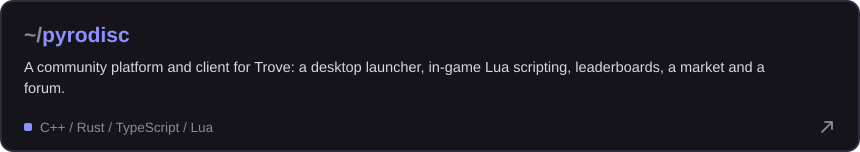
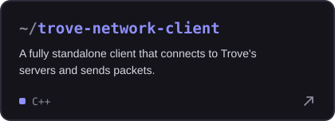
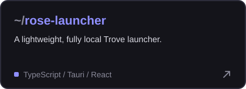
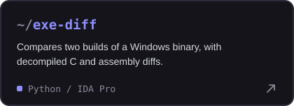
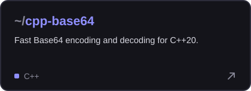
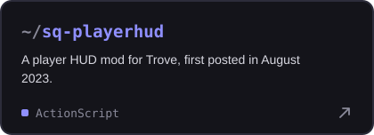
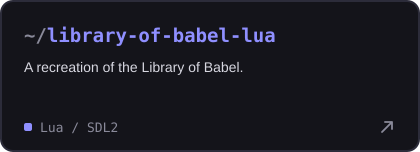
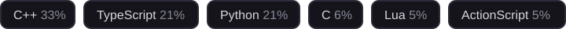

  

  
  
  

## `~/about`

I take games apart to see how they work, then build on top of what I find.

I'm a self-taught programmer from Gothenburg, Sweden, with 5+ years of writing C++, TypeScript, Python, C and Lua. It usually starts the same way: a game does something I can't explain, I open it up, and a few weeks later there is a tool, a mod or a whole client that did not exist before.

- Reverse engineering and game modding
- Network protocols and standalone clients
- Tools for comparing and analysing Windows binaries
- Desktop apps, launchers and the websites around them

## `~/now`

Most of my time goes into **Pyrodisc**, which I build and run.

[Website](https://www.pyrodisc.one) · [Docs](https://docs.pyrodisc.one) · [GitHub](https://github.com/Pyrodisc) · [Discord](https://discord.gg/MpgUcSdNH6)

## `~/projects`

## `~/stack`

Share of the code in my public repositories.

## `~/contact`

Open to ideas and to working together. The fastest way to reach me is Discord: `@nepo._.`
